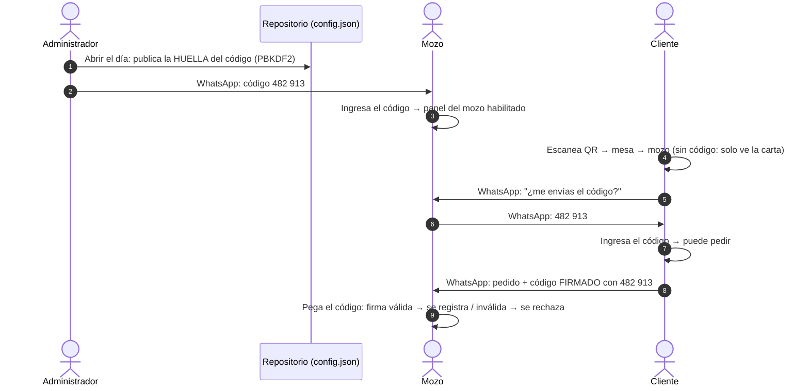

# Código del día

| | |
|---|---|
| **Estado** | Implementado |
| **Módulos** | `js/jornada.js`, `js/codec.js` (firma), `js/acceso.js`, `js/views/cliente.js`, `js/views/mozo.js`, `js/views/panel.js` |
| **Datos publicados** | `data/config.json` → `jornada` |
| **Fecha** | 2026-11-02 |

## 1. Problema

La carta es un sitio público (GitHub Pages). Los enlaces de mesa (`?mesa=7`) y de delivery (`?delivery=987654321&m=2`) se pueden reenviar a cualquiera. Además, el control de los códigos de pedido era un CRC32, que cualquiera puede recalcular. Así, una persona ajena al local podía:

- llenar de pedidos falsos el WhatsApp de los mozos desde un enlace filtrado, o
- fabricar un código de pedido válido sin pasar por la carta.

## 2. Solución

El acceso a la interacción depende de un **código de 6 dígitos que cambia cada día** y que solo circula por WhatsApp entre el administrador, los mozos y los clientes que están siendo atendidos.



### 2.1 Qué puede hacer cada uno sin código

| Actor | Sin código | Con código |
|---|---|---|
| Cliente (mesa) | Ver la carta, buscar y filtrar | Agregar platos y enviar el pedido |
| Cliente (delivery) | Ver la carta | Pedir. El mozo le envía el código en el mismo mensaje del enlace |
| Mozo | Nada: el panel pide el código | Usar el panel. Solo se aceptan pedidos firmados con el código vigente |
| Administrador / Dueño | Abrir, cambiar o cerrar el día | — |

## 3. Operación diaria

### Administrador (al empezar el turno)

1. Abre **Panel → 🔑 Código del día → Abrir el día**. El dispositivo necesita estar conectado a GitHub (pestaña Publicación). En modo local (`servidor.py`), hazlo desde la PC del servidor en `http://localhost`.
2. Espera ≈ 1 minuto mientras GitHub Pages publica el cambio. En modo local es inmediato.
3. En la lista de mozos, toca **Enviar** junto a cada mozo que trabaja hoy. Se abre WhatsApp con el código y las instrucciones; el panel marca a quiénes ya se les envió.

### Mozo

1. Abre `…/#/mozo` e ingresa el código. El celular lo recuerda hasta que vence o cambia.
2. Cuando un cliente le pide el código por WhatsApp, se lo responde.
3. Para un delivery, el mensaje con el enlace incluye el código automáticamente.

### Si el código se filtró

**Cambiar código** genera uno nuevo y el anterior deja de servir apenas se publica. Después hay que reenviar el nuevo a los mozos. Los clientes que tenían el anterior verán «Ingresa el código para enviar» y deberán pedirlo de nuevo.

### Al terminar

El día **se cierra solo** a la hora de cierre del **horario de atención** (por defecto **6:00 a. m. → 6:00 a. m.**, hora de Perú), aunque nadie lo cierre. El horario se edita en la misma pestaña («⏰ Horario de atención»). Si hay un día abierto, su cierre automático se recalcula y se activa al publicar. **Cerrar el día** lo desactiva antes.

## 4. Diseño técnico

### 4.1 Lo que se publica

`data/config.json` nunca contiene el código, solo su huella:

```json
"jornada": {
  "id": "8RH6dyjx",
  "sal": "base64 (16 bytes aleatorios)",
  "iter": 150000,
  "hash": "base64 (PBKDF2-HMAC-SHA256, 256 bits)",
  "abierta": 1793640000000,
  "vence": 1793704800000
}
```

`jornada: null` significa que el día está cerrado. Cualquier valor mal formado se normaliza a `null` (`normalizarJornada`).

```json
"horario": { "inicio": "06:00", "cierre": "06:00" }
```

`vence` se calcula con `proximoCierre()`: es la próxima hora de cierre en hora de Perú (UTC−5, sin horario de verano). Si esa hora está a menos de 1 h, se toma la del día siguiente, para que un día abierto a las 5:30 con cierre a las 6:00 no se cierre a los 30 minutos. Un horario inválido vuelve al de por defecto (`normalizarHorario`).

### 4.2 Generación

- `generarCodigo()` usa `crypto.getRandomValues` con muestreo por rechazo: los valores entre 000000 y 999999 tienen exactamente la misma probabilidad.
- `crearJornada()` genera una sal nueva por cada código y deriva la huella con PBKDF2 (150 000 iteraciones).

### 4.3 Validación (`validarCodigo`)

1. Normaliza a 6 dígitos (acepta `482 913`).
2. Comprueba que el día esté vigente: `abierta − 10 min ≤ ahora < vence`. La tolerancia cubre relojes de celular desfasados.
3. Deriva la huella y la compara en tiempo constante.
4. Si falla, **vuelve a leer `config.json` una vez**, porque el administrador pudo abrir o cambiar el día después de cargar la página.
5. Tras 5 fallos seguidos, el dispositivo espera 60 s antes de aceptar otro intento.
6. Si acierta, guarda `{ id, codigo }` en `jornada.codigo`. El `id` amarra el código a esa jornada: cuando se rota o vence, deja de reconocerse solo.

### 4.4 Firma de pedidos (`codec.js`)

```
[#MESA05-YDCHRS:<datos>:<crc32>:<firma>]
firma = base36( SHA-256( códigoDelDía | "#MESA05-YDCHRS:<datos>" ) )[41 bits, 8 caracteres]
```

- El cliente firma al generar el enlace de WhatsApp. Sin código no se genera el enlace.
- El mozo verifica con el código que ingresó (`firmaValida`).
  - **Sin firma** → se rechaza con «no trae el código del día».
  - **Firma de otro código** → el panel relee la configuración. Si el código del día cambió, pide el nuevo; si no, rechaza el pedido por venir de un enlace filtrado o ser falso.
- Los pedidos manuales del mozo no se firman porque no viajan por WhatsApp.

### 4.5 Datos locales

| Clave (`localStorage`, prefijo `carta.`) | Dónde | Contenido |
|---|---|---|
| `jornada.codigo` | Cliente / mozo | `{ id, codigo }` ya validado |
| `jornada.intentos` | Cliente / mozo | `{ fallos, hasta }` para el límite de intentos |
| `jornada.admin` | Administrador | `{ id, codigo }`: el único lugar donde se puede volver a ver el código |
| `jornada.enviados` | Administrador | Mozos a los que ya se les envió el código |

## 5. Modelo de amenazas

| Amenaza | Resultado |
|---|---|
| Enlace de mesa o delivery reenviado a terceros | ✅ Sin código solo ven la carta; no pueden pedir |
| Pedido fabricado a mano (sin pasar por la carta) | ✅ El mozo lo rechaza: no tiene firma válida |
| Enlace o código de un día anterior | ✅ El día se cierra solo a la hora de cierre; la firma con un código viejo se rechaza |
| Alguien lee `config.json` | ⚠️ Ve la huella, no el código. Probar las 10⁶ combinaciones con PBKDF2 (150 000 iteraciones) cuesta horas en una CPU, pero **minutos con una GPU dedicada** |
| Un cliente reenvía el código del día a otros | ⚠️ No se puede impedir sin servidor. Mitigación: **Cambiar código**; además, el mozo ve el número de WhatsApp de quien envía cada pedido |
| Un mozo comparte el código | ⚠️ Riesgo de confianza. Se mitiga rotando el código |

> **Límite de diseño.** Sin servidor, cualquier verificación que hace el navegador puede estudiarse. El código del día es una **barrera disuasiva fuerte** contra el uso casual de enlaces filtrados y los pedidos fabricados, no una autenticación de servidor. Para eso haría falta un backend (por ejemplo, una función serverless que emita códigos por mesa y valide los pedidos).

## 6. Parámetros

| Constante | Valor | Archivo |
|---|---|---|
| `LARGO_CODIGO` | 6 | `jornada.js` |
| `ITERACIONES` | 150 000 | `jornada.js` |
| `HORARIO_POR_DEFECTO` | 06:00 → 06:00 (cierre automático, editable) | `jornada.js` |
| `MIN_JORNADA_MS` | 1 h (margen mínimo hasta el cierre) | `jornada.js` |
| `TOLERANCIA_RELOJ_MS` | 10 min | `jornada.js` |
| `MAX_FALLOS` / `ESPERA_FALLOS_MS` | 5 / 60 s | `jornada.js` |
| Largo de la firma | 8 caracteres base 36 (41 bits) | `codec.js` |

## 7. Solución de problemas

| Síntoma | Causa probable | Qué hacer |
|---|---|---|
| «El local aún no abrió los pedidos de hoy» | El día no está abierto o la publicación aún no llega (≈ 1 min) | Abrir el día y esperar un minuto |
| El mozo no puede entrar a su panel | El día no está abierto, o el código cambió o venció | Pedir el código vigente al administrador |
| «Este pedido no trae el código del día» | El cliente usó una versión vieja de la página o un código fabricado | Que el cliente recargue la carta, ingrese el código y reenvíe |
| «se hizo con un código que no es el de hoy» | Enlace filtrado o código de otro día | No atender; si es un cliente real, darle el código vigente |
| El administrador no ve el código | Se generó en otro dispositivo (solo se publica la huella) | **Cambiar código** y reenviarlo |
| «Demasiados intentos» | 5 fallos seguidos | Esperar 60 s |
