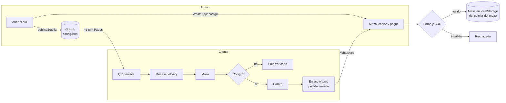

# Revisión técnica: puntos de ruptura de la interacción

| | |
|---|---|
| **Sistema** | Carta digital (SPA estática en GitHub Pages + WhatsApp) |
| **Alcance** | Flujo completo cliente → WhatsApp → mozo, delivery, panel de administración y publicación |
| **Método** | Revisión de código asistida (skill `code-review`, nivel *high*) sobre los cambios de delivery, análisis manual de cada etapa del flujo y pruebas automatizadas de extremo a extremo en Chrome |
| **Fecha** | 2026-11-02 |

## 1. Resumen ejecutivo

El sistema no tiene servidor: cada etapa depende del navegador, de WhatsApp y de GitHub Pages. La revisión encontró **42 puntos de ruptura**, agrupados en seis áreas:

| Severidad | Total | ✅ Corregidos / 🛡️ mitigados | ℹ️ Aceptados por diseño | ⚠️ Abiertos |
|---|---|---|---|---|
| 🔴 Crítica / alta | 10 | 7 | 1 | 2 |
| 🟠 Media | 18 | 12 | 2 | 4 |
| 🟢 Baja / informativa | 14 | 8 | 5 | 1 |
| **Total** | **42** | **27** | **8** | **7** |

**Corregido en esta revisión**

- **Pedidos falsos desde enlaces filtrados.** Ahora se usa un código del día y cada pedido va firmado ([CODIGO-DEL-DIA.md](CODIGO-DEL-DIA.md)).
- Los 7 errores que encontró la revisión de código en delivery.
- Validación estricta del contenido de los pedidos (cantidades, precios y textos).
- Los enlaces de ubicación ya no pueden llevar al mozo a una página de *phishing*.

**Requiere acción del dueño**

1. **S5: las claves del dueño y del administrador siguen siendo las iniciales**, y esas claves están escritas en el `README.md` público. Hay que cambiarlas en *Panel del Dueño → Accesos → Publicar*.
2. **D1: el estado de las mesas vive solo en el celular de cada mozo.** Si se borran los datos del navegador o se cambia de celular, se pierde.
3. **O1: después de publicar esta versión, nadie podrá pedir por la app hasta que se abra el primer día.**

## 2. Mapa de la interacción

Cada flecha es un punto donde la interacción puede romperse. Las tablas siguientes recorren el flujo de izquierda a derecha.

## 3. Puntos de ruptura

Estados: ✅ corregido · 🛡️ mitigado · ⚠️ abierto (acción recomendada) · ℹ️ aceptado por diseño

### 3.1 Seguridad e integridad

| ID | Escenario | Impacto | Sev. | Estado |
|---|---|---|---|---|
| S1 | Un enlace público (`?mesa=`, `?delivery=`) se reenvía y terceros envían pedidos | WhatsApp de los mozos saturado con pedidos falsos | 🔴 | ✅ Código del día; sin él solo se ve la carta |
| S2 | El control del código de pedido era un CRC32, que cualquiera recalcula, así que se podían fabricar pedidos | Pedidos falsos indistinguibles de los reales | 🔴 | ✅ Firma SHA-256 con el código del día; el mozo rechaza pedidos sin firma o con firma inválida |
| S3 | El campo `ubicacion` del delivery aceptaba cualquier URL https (revisión #5) | El botón «Ubicación» del mozo podía abrir una página de *phishing* | 🔴 | ✅ Solo se aceptan coordenadas y el enlace se reconstruye siempre hacia Google Maps (`mapaDesdeUbicacion`) |
| S4 | El contenido del pedido no se validaba: cantidades negativas, precios absurdos, textos enormes o tipos incorrectos (revisión #6) | Totales y reportes corruptos; interfaz rota | 🟠 | ✅ `decodificarPedido` valida cantidad (1–99), precio (≤ S/ 10 000), máximo 60 líneas y largo de textos |
| S5 | Las claves iniciales (`dueno2026`, `admin2026`) están en el `README.md` público y son las que trae `config.json` | Cualquiera entra a los paneles de dueño y admin (no puede publicar sin el token de GitHub) | 🔴 | ⚠️ **Cambiar ambas claves ya.** Considerar quitarlas del README; igual quedan en el historial de git |
| S6 | Los hashes de las claves (SHA-256 sin sal) son públicos | Una clave corta se adivina por fuerza bruta | 🟠 | ⚠️ Usar claves largas (≥ 12 caracteres). La barrera real para modificar la web es el token de GitHub |
| S7 | Fuerza bruta del código del día con la huella de `config.json` | Un atacante con una GPU dedicada obtiene el código en minutos | 🟠 | 🛡️ PBKDF2 con 150 000 iteraciones y sal; el día se cierra solo a la hora de cierre; se puede rotar. Límite inherente sin servidor |
| S8 | Un cliente reenvía el código a terceros durante el día | Pedidos de personas que no están en el local | 🟠 | ℹ️ Mitigación operativa: **Cambiar código**; el mozo ve el número de quien envía |
| S9 | El token de GitHub queda en `localStorage` de los dispositivos conectados | Si se pierde el celular, alguien podría publicar | 🟠 | ℹ️ Documentado: revocarlo en GitHub. Usar un token *fine-grained* limitado al repositorio |

### 3.2 Operación del día

| ID | Escenario | Impacto | Sev. | Estado |
|---|---|---|---|---|
| O1 | No se abre el día (olvido, o el dispositivo no tiene token) | Nadie puede pedir por la app y los mozos no pueden usar su panel | 🔴 | ℹ️ Por diseño. Mensajes claros en cada pantalla. **Al desplegar esta versión, abrir el primer día** |
| O2 | El código se usa antes de que GitHub Pages publique (≈ 1 min) | «El local aún no abrió…» | 🟢 | 🛡️ Al fallar, la validación vuelve a leer `config.json` |
| O3 | Se cambia el código en pleno servicio | Clientes con carrito y mozos con el código viejo quedan bloqueados | 🟠 | 🛡️ El carrito muestra «Ingresa el código para enviar»; el mozo es enviado de vuelta a la pantalla del código |
| O4 | Se olvida cerrar el día, o el turno cruza la hora de cierre | El código seguiría vigente / vencería a mitad del turno | 🟢 | ✅ Cierre automático a la hora de cierre del horario (por defecto 6:00 a. m. → 6:00 a. m., editable) |
| O5 | Reloj del celular muy desfasado | El código parece cerrado o vencido | 🟢 | 🛡️ Tolerancia de 10 min |
| O6 | Sin acceso a `cdn.tailwindcss.com` o Google Fonts, o primera carga lenta (medida: más de 9 s en un perfil nuevo) | Sitio sin estilos o lento | 🟠 | ⚠️ Recomendado: compilar Tailwind a un CSS estático |
| O7 | Solo un dispositivo tiene el token | Si ese celular falta, no se puede abrir el día | 🟠 | ⚠️ Conectar al menos dos dispositivos (dueño y admin) |
| O8 | El código solo se puede ver en el dispositivo que lo generó | El admin no puede reenviarlo desde otro celular | 🟢 | ℹ️ **Cambiar código** genera uno nuevo |
| O9 | PBKDF2 en celulares de gama baja | 0,3–1 s por intento | 🟢 | ℹ️ Aceptable; el botón muestra «Verificando…» |

### 3.3 Cliente

| ID | Escenario | Impacto | Sev. | Estado |
|---|---|---|---|---|
| C1 | La ubicación llega después de que el cliente pasó a la carta (revisión #1) | La ubicación se perdía aunque se mostraba «Ubicación agregada ✓» | 🟠 | ✅ Se agrega a la entrega guardada y se recalcula el enlace |
| C2 | El mismo cliente recibe un nuevo link de delivery de **otro** mozo (revisión #2) | El pedido iba al mozo anterior | 🔴 | ✅ El mozo del enlace (`m=`) siempre manda |
| C3 | El cliente eligió un mozo por error en un delivery sin `m` (revisión #3) | No podía cambiarlo | 🟠 | ✅ Solo queda fijo el mozo que viene en el enlace |
| C4 | Se escanea el QR de otra mesa con la sesión abierta | Mesa equivocada | 🟢 | 🛡️ Si la mesa del QR es distinta, se vuelve a la bienvenida |
| C5 | Se redujo el número de mesas y hay QR viejos impresos | `?mesa=30` inválida | 🟢 | 🛡️ Se ignora y el cliente elige la mesa |
| C6 | Varios comensales piden desde celulares distintos | Varios pedidos en la misma mesa | ℹ️ | ℹ️ Por diseño; el mozo les pone alias |
| C8 | El cliente (o el dueño, al probar) abre el link y la carta muestra directo una mesa activa de antes | No puede empezar el flujo desde cero | 🟢 | ✅ Botón ↺ **Empezar de nuevo**: borra la sesión de la carta (no la del mozo) y vuelve a la intro |
| C9 | El ingreso del código quedaba arriba y se perdía al bajar por la carta | El cliente no encuentra cómo pedir | 🟠 | ✅ Barra fija abajo con **Pedir código** e **Ingresar código** |
| C7 | La carta se abre dentro de Instagram o Facebook | `wa.me` o la geolocalización pueden bloquearse | 🟢 | ⚠️ Recomendar abrir en Chrome o Safari |

### 3.4 Transporte por WhatsApp

| ID | Escenario | Impacto | Sev. | Estado |
|---|---|---|---|---|
| W1 | El cliente edita el mensaje o WhatsApp parte el código en varias líneas | Código corrupto | 🟠 | 🛡️ El CRC detecta la edición; se ignoran espacios y saltos de línea; el alfabeto evita `_ * ~ \`` |
| W2 | El cliente abre WhatsApp pero no presiona **Enviar** | El mozo nunca recibe el pedido | 🟠 | 🛡️ Pantalla «¡Pedido listo!» con «Abrir WhatsApp de nuevo». No se puede confirmar sin servidor |
| W3 | Número del mozo mal escrito en la configuración | Los pedidos van a un desconocido | 🔴 | 🛡️ Se validan 9 dígitos y hay un botón «Probar WhatsApp» en el panel |
| W5 | El cliente reenvía o edita un pedido ya enviado (quedaba en el carrito y había «Volver a mi pedido» / «Abrir WhatsApp de nuevo») | El mozo no sabe si es un pedido nuevo, un adicional o un duplicado | 🔴 | ✅ Al enviar, el carrito se vacía y no se guarda nada; el mensaje dice NUEVO o ADICIONAL; los cambios los hace el mozo. El reintento usa el mismo ID y el panel lo marca como duplicado |
| W6 | Varios pedidos de la misma mesa llegan en distintos momentos | El mozo pierde de vista lo que se agregó | 🟠 | ✅ «📥 Pedidos recibidos» con «sin ver», distintivo 🆕 en la mesa y pedidos numerados (N.º 1, 2…) dentro de la cuenta |
| W4 | Pedido muy grande, con una URL `wa.me` muy larga | Algunos navegadores truncan la URL | 🟢 | 🛡️ Compresión deflate y tope de 60 líneas |

### 3.5 Panel del mozo y datos

| ID | Escenario | Impacto | Sev. | Estado |
|---|---|---|---|---|
| D1 | Mesas, pedidos e historial viven **solo** en `localStorage` del celular | Si se borran los datos, se cambia de celular o se usa modo incógnito, se pierde todo | 🔴 | ⚠️ Límite de la arquitectura. Recomendado: un solo dispositivo central de caja, o un backend con sincronización |
| D2 | Dos mozos pegan el mismo pedido en celulares distintos | Doble registro y reportes inflados | 🟠 | ⚠️ La detección de duplicados es por dispositivo. Acordar que cada pedido lo pega el mozo destinatario |
| D3 | La tarjeta de delivery mostraba la dirección más antigua (revisión #4) | El repartidor podía ir a la dirección equivocada | 🔴 | ✅ Tarjeta, detalle y cuenta usan la misma fuente (`entregaDe`) |
| D4 | Delivery con pedidos manuales: la cuenta salía sin teléfono (revisión #7) | No se podía enviar la cuenta | 🟠 | ✅ Se usa el celular de la clave de delivery |
| D5 | Historial limitado a 7 días / 1500 eventos y cuota de `localStorage` (~5 MB) | Reportes antiguos se pierden | 🟢 | ℹ️ Imprimir el reporte al cerrar el día |
| D6 | La sincronización funciona solo entre pestañas del mismo navegador | Dos celulares no comparten estado | ℹ️ | ℹ️ Ver D1 |

### 3.6 Administración y publicación

| ID | Escenario | Impacto | Sev. | Estado |
|---|---|---|---|---|
| P1 | Dos dispositivos publican a la vez | Se pisan cambios | 🟠 | 🛡️ Se detecta el conflicto con el `sha` de GitHub y se pide confirmar |
| P2 | Al abrir el día se publican también otros cambios pendientes del borrador | Cambios publicados sin intención | 🟢 | 🛡️ Se avisa en la confirmación |
| P3 | Token vencido o sin permiso de escritura | No se puede publicar ni abrir el día | 🟠 | 🛡️ Se valida al conectar y el error se muestra al publicar |

## 4. Hallazgos de la revisión de código (skill `code-review`, nivel *high*)

| # | Archivo | Hallazgo | Estado |
|---|---|---|---|
| 1 | `cliente.js` | La ubicación tardía se perdía | ✅ C1 |
| 2 | `cliente.js` | La sesión de delivery ignoraba el `m` de un enlace nuevo | ✅ C2 |
| 3 | `cliente.js` | No se podía cambiar el mozo elegido en un delivery | ✅ C3 |
| 4 | `mozo.js` | La tarjeta usaba la dirección más antigua | ✅ D3 |
| 5 | `mozo.js` | URL arbitraria en «Ubicación» | ✅ S3 |
| 6 | `mozo.js` | Alias y textos sin acotar ni validar | ✅ S4 |
| 7 | `mozo.js` | Cuenta de delivery sin teléfono | ✅ D4 |
| 8 | `cliente.js` / `mozo.js` | Normalización del celular duplicada | ✅ `normalizarCelular` y `formatoCelular` en `codec.js` |
| 9 | `mozo.js` | Delivery codificado como clave `"D…"` dentro del mapa de mesas (riesgo de regresión) | ⚠️ Se centralizó en `claveMesa`/`etiquetaMesa` y se hizo explícita la comparación en `restaurarEvento`. Recomendado a futuro: colección separada para delivery |
| 10 | `mozo.js` | `deliveries()` y `resumenMesa` se calculaban varias veces por repintado | ✅ Se calculan una vez por repintado |

## 5. Pruebas realizadas

Pruebas automatizadas en Chrome (sin interfaz gráfica, controlado por CDP) sobre una copia local con un día abierto. **32 de 32 comprobaciones automáticas correctas, sin errores de JavaScript**, más una revisión visual de cada pantalla nueva.

| Flujo | Comprobaciones |
|---|---|
| Cliente con código | Paso 3 visible; enlace «Pedir código» con la mesa; código errado rechazado; código correcto da acceso a la carta; pedido firmado |
| Cliente sin código | Franja «Estás viendo la carta»; «+» abre la hoja del código sin agregar nada; tras el código se agrega el plato pendiente |
| Panel del mozo | Pide el código; rechaza uno errado; acepta un pedido firmado; rechaza uno **sin firma** y uno **firmado con otro código**; detecta duplicados |
| Delivery | El enlace que envía el mozo incluye el código; tras la dirección se pide el código; pedido delivery firmado |
| Día cerrado | El cliente ve el aviso; un código viejo no sirve; el mozo ve «el día aún no está abierto» con un mensaje para el mozo |
| Administrador | Pestaña «Código del día» primera; estado del día; código oculto en otro dispositivo; código visible y envío por WhatsApp a cada mozo en el dispositivo que lo generó |
| Codec (Node) | Firma válida y rechazada; mapa malicioso neutralizado; textos acotados; cantidad negativa rechazada; celular normalizado |

## 6. Recomendaciones priorizadas

1. **Hoy:** cambiar las claves de dueño y administrador (S5) y abrir el primer día (O1).
2. **Esta semana:** conectar un segundo dispositivo con token (O7) y definir qué mozo pega cada pedido (D2).
3. **Corto plazo:** compilar Tailwind a CSS estático (O6).
4. **Mediano plazo:** si el volumen crece, un backend mínimo (por ejemplo, funciones serverless con una base de datos) resolvería D1, D2, S7 y W2 a la vez: estado compartido entre mozos, códigos por mesa y confirmación de recepción.
